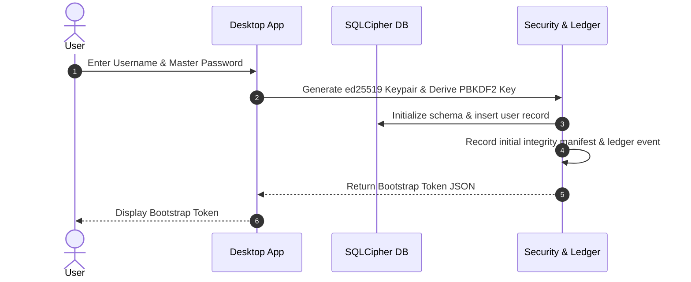

# NexVault — Comprehensive Installation, Setup & Architecture Guide

NexVault is a local-first, zero-knowledge password manager, OTP 2FA authenticator, and trusted-device peer-to-peer network. Vault data lives exclusively on user devices, encrypted locally with SQLCipher and communicated across devices via end-to-end encrypted WebRTC channels negotiated over a lightweight, zero-knowledge signaling relay.

> [!NOTE]
> For a deep-dive breakdown of all features, cryptographic protocols, TOTP math, bulk migration parsers, and inner security strategy, consult [FEATURES_AND_INNER_STRATEGY.md](file:///home/youssef/projects/nextvault/FEATURES_AND_INNER_STRATEGY.md).

---

## Table of Contents

1. [Architecture & How It Works](#1-architecture--how-it-works)
   - [Core Principles](#core-principles)
   - [Cryptographic Primitives](#cryptographic-primitives)
   - [Network & Port Architecture](#network--port-architecture)
   - [Extension Bridge Protocol](#extension-bridge-protocol)
2. [Prerequisites](#2-prerequisites)
3. [Installation](#3-installation)
4. [Running & Setting Up Each Component](#4-running--setting-up-each-component)
   - [Signaling Relay Server](#signaling-relay-server)
   - [Desktop Vault (Electron)](#desktop-vault-electron)
   - [Browser Extension (Chrome / Edge / Brave)](#browser-extension-chrome--edge--brave)
   - [Mobile App (Android / Capacitor)](#mobile-app-android--capacitor)
   - [Website & Landing Page](#website--landing-page)
5. [End-to-End User Workflows](#5-end-to-end-user-workflows)
   - [Bootstrapping a New Vault](#bootstrapping-a-new-vault)
   - [Pairing a Second Device](#pairing-a-second-device)
   - [Using Browser Autofill](#using-browser-autofill)
   - [TOTP Two-Factor Authentication](#totp-two-factor-authentication)
6. [Security Model & Safeguards](#6-security-model--safeguards)
   - [24-Hour Heartbeat & Dead Man's Switch](#24-hour-heartbeat--dead-mans-switch)
   - [Offline Window Extensions & Peer Approvals](#offline-window-extensions--peer-approvals)
   - [Storage Integrity Monitor](#storage-integrity-monitor)
   - [Append-Only Trust Ledger](#append-only-trust-ledger)
   - [Emergency Cryptographic Nuke](#emergency-cryptographic-nuke)
7. [Troubleshooting & FAQs](#7-troubleshooting--faqs)

---

## 1. Architecture & How It Works

### Core Principles

- **Zero Cloud Storage**: Master keys, passwords, and OTP secrets never touch a remote server.
- **Peer-to-Peer Mesh**: Devices connect directly via WebRTC data channels using STUN/TURN for NAT traversal.
- **Zero-Knowledge Relay**: The signaling server only verifies device authorization signatures and routes WebRTC SDP offers/answers. It cannot inspect vault data.
- **Defense in Depth**: Combines SQLCipher database encryption, AES-256-GCM local inter-process encryption, X25519 peer messaging, and filesystem integrity hashing.

### Cryptographic Primitives

```
+-------------------------------------------------------------------------+
|                        Device Identity & Signing                        |
|                     ed25519 (tweetnacl.sign)                            |
+-------------------------------------------------------------------------+
|     Asymmetric Peer Encryption      |     Local Symmetric Encryption    |
|        X25519 (tweetnacl.box)       |  XSalsa20-Poly1305 / AES-256-GCM  |
+-------------------------------------------------------------------------+
|      Key Derivation (PBKDF2)        |       Database Storage Engine     |
|   PBKDF2-HMAC-SHA256 (210k rounds)  |    SQLCipher (AES-256-CBC, PBKDF2)|
+-------------------------------------------------------------------------+
```

1. **Device Identity (`NexVaultToken`)**: Every device generates an ed25519 keypair. The public key acts as the `deviceId`. A signed `bootstrapToken` is created to authoritatively pair additional devices.
2. **Key Derivation**: The user's master password is mixed with the device identity salt through PBKDF2 (210,000 iterations, SHA-256) to produce the local encryption key.
3. **Database Security (`NexVaultDatabase`)**: Stored on disk as `nexvault.db` utilizing SQLCipher (`better-sqlite3-multiple-ciphers`) with random 256-bit database keys protected by OS keychain storage (`safeStorage`).
4. **P2P Encryption (`NexGrid`)**: Peer-to-peer data channel communications use ephemeral X25519 key exchange (`nacl.box`) sealed per-session.

### Network & Port Architecture

| Port | Service | Host Interface | Description |
|---|---|---|---|
| **`46123`** | **Signaling Relay Server** | `0.0.0.0` | Node.js WebSocket server (`apps/relay`). Routes SDP offers, answers, and ICE candidates between authenticated devices under the same `tokenId`. |
| **`46124`** | **Extension Bridge Server** | `127.0.0.1` | Local WebSocket server spawned by the Desktop app (`apps/desktop`). Securely serves credentials to the browser extension. |

### Extension Bridge Protocol

The browser extension communicates with the desktop app on `127.0.0.1:46124`:
1. **Handshake**: Extension transmits `{ type: 'extension-auth', token: bootstrapToken }`.
2. **Key Establishment**: The desktop verifies the ed25519 signature of the bootstrap token. Both endpoints derive an AES-256 session key from `SHA256(tokenId)`.
3. **Encrypted Requests**: All subsequent queries (`get-password`, `search-vault`) are encrypted using `AES-256-GCM` with random 12-byte initialization vectors and 16-byte authentication tags.

---

## 2. Prerequisites

- **Node.js**: Version 20.x or newer
- **npm**: Version 10.x or newer
- **Linux / macOS / Windows**
- *(Optional for Android builds)*:
  - **JDK 21**
  - **Android SDK** (`cmdline-tools`, `platform-tools`, `platforms;android-34`)
  - Environment variables set (see `.env.dev` for an example template)

---

## 3. Installation

NexVault is organized as a monorepo. Install dependencies for all packages and applications:

```bash
# 1. Install root dependencies and tooling
npm install

# 2. Install core cryptographic and database package
npm --prefix packages/core install

# 3. Install desktop Electron app
npm --prefix apps/desktop install

# 4. Install relay server
npm --prefix apps/relay install

# 5. Install mobile app dependencies
npm --prefix apps/mobile install

# 6. Install website landing page dependencies
npm --prefix apps/website install
```

---

## 4. Running & Setting Up Each Component

### Signaling Relay Server

The relay server orchestrates WebRTC signaling for peer discovery.

```bash
# Start the dev relay on http://0.0.0.0:46123
npm run start:relay
```

- **Health check**: Visit `http://localhost:46123/health` -> `{"status":"ok"}`.
- **Production Deployment**: Deploy `apps/relay` to Render, Railway, Fly.io, or VPS with persistent WebSocket support. Configure the `PORT` and `HOST` environment variables as needed.

### Desktop Vault (Electron)

The desktop application is the central command center for vault management, OTP generation, and browser autofill bridging.

```bash
# Start Desktop App
npm run start:desktop
```

- When first launched, click **New User**, enter a username and master password, and click **Generate Bootstrap Token**.
- Copy the generated JSON token and save it safely; this token is required to pair additional devices (mobile and browser extension).

To build the standalone Linux binary:
```bash
npm run build:desktop
# Outputs unpackaged build to apps/desktop/dist/linux-unpacked/
```

### Browser Extension (Chrome / Edge / Brave)

1. Open your browser and navigate to the extensions management page:
   - Chrome / Brave: `chrome://extensions`
   - Edge: `edge://extensions`
2. Enable **Developer mode** (toggle in the top-right corner).
3. Click **Load unpacked** and select the directory:
   ```
   <repo-root>/apps/extension/src
   ```
4. Click the **NexVault** shield icon in your browser toolbar:
   - Click **Settings** in the popup header.
   - Paste the bootstrap token JSON generated by your desktop app.
   - Click **Save Token**.
   - Return to the vault view and click **Connect to NexVault**.
   - The status indicator will turn green: `CONNECTED TO NEXVAULT`.
5. **1Password-Style In-Field Experience**:
   - When browsing any web page with login or registration inputs, a glowing NexVault shield icon automatically appears inside the field.
   - Clicking the badge opens a glassmorphic floating menu to autofill saved credentials with one click or generate strong passwords.

### Mobile App (Android / Capacitor)

#### Local Web Preview
```bash
npm run start:mobile
```
Opens Vite development server on `http://localhost:5173`.

#### Android Build & Deployment
```bash
# Compile React application
npm run build:mobile

# Sync Capacitor assets to native Android project
npx --prefix apps/mobile cap sync android

# Assemble debug APK
npm run build:mobile:android
```
The compiled APK will be located at:
`apps/mobile/android/app/build/outputs/apk/debug/app-debug.apk`

### Website (React + Vite + Tailwind CSS)

The website is a modern React application powered by Vite, Tailwind CSS, and the cinematic Canvas binary shield animation.

```bash
# Start Vite development server with Hot Module Replacement (HMR)
npm --prefix apps/website run dev

# Build production static bundle (dist/)
npm run build:website

# Build release artifacts and bundle into production website
npm run release
```
Serve `apps/website/dist` with any static host (Nginx, Netlify, Vercel, or `npx serve apps/website/dist`).

---

## 5. End-to-End User Workflows

### Bootstrapping a New Vault



### Pairing a Second Device

1. On the primary device (Desktop), copy the bootstrap token JSON:
   ```json
   {
     "tokenId": "nexvault-lxyz123-abc456",
     "publicKey": "base64-ed25519-public-key",
     "signature": "base64-detached-signature",
     "expiresAt": "2026-11-28T21:00:00.000Z"
   }
   ```
2. On the second device (Mobile or second Desktop):
   - Select **Existing Network / Existing User**.
   - Paste the token JSON.
   - Enter the identical master password.
   - Click **Validate & Unlock**.
3. Both devices connect to the signaling relay with their device tokens, identify peer presence under the same `tokenId`, and establish an end-to-end encrypted WebRTC data channel.

### Using Browser Autofill (Desktop & Android Chrome)

1. **Desktop**:
   - Ensure the Desktop app is running and unlocked.
   - The native bridge runs on `127.0.0.1:46124`. The browser extension detects input fields on active web pages and provides seamless autofill upon user click.
2. **Android Mobile (Native Apps & Chrome Browsers)**:
   - Ensure NexVault is selected as your system Autofill service under **Android Settings → System → Languages & Input → Autofill service**.
   - In **Google Chrome** on Android: Tap **⋮ (Menu) → Settings → Autofill options → Autofill using another service**.
   - NexVault's native autofill service detects website domains, URL address bar text, and login forms across Chrome, Chromium, Brave, Firefox, and native Android apps, delivering instant credential datasets.

### TOTP Two-Factor Authentication & Google Authenticator-Style UI

1. In Desktop or Mobile, navigate to the **Authenticator** section.
2. Enter the service name (e.g. `github.com`) and the base32 secret (or scan a QR code using Mobile camera or image upload).
3. Click **Save TOTP**.
4. The service appears with Google Authenticator-style styling:
   - **Circular Countdown Rings**: Animated SVG progress rings displaying remaining seconds in the 30-second window, turning red when under 5 seconds.
   - **High-Contrast Formatted Codes**: Spaced 6-digit codes (`123 456`) in clean monospace font.
   - **Tap-to-Copy**: Click anywhere on the card or the copy button for instant clipboard access with visual "✓ Copied" confirmation.
   - **Inline Search**: Filter authenticators instantly by service name.
   - **Inline Edit & Parity**: Edit existing authenticators (service labels and secrets) and credentials on both Desktop and Mobile.

---

## 6. Security Model & Safeguards

### Configurable Inactivity Auto-Lock

Both Desktop and Mobile feature an inactivity auto-lock system configurable in Settings:
- Selectable timeouts: **1 min**, **2 min**, **5 min (default)**, **15 min**, **30 min**, or **Disabled / Never**.
- Inactivity monitors keypress, mouse movement, and touch interactions.
- Upon auto-lock, active decryption keys in memory are overwritten with zeroes and local databases close.

### 24-Hour Heartbeat & Dead Man's Switch

NexVault includes an active security countdown timer:
- Devices maintain a 24-hour authorization window from the time of last authentication or active peer connection.
- Settings and Security tabs display the real-time remaining countdown (e.g. `23h 48m remaining`).
- If all peers disconnect and no authentication occurs before the timer expires, an emergency cryptographic destruction process is queued.

### Offline Window Extensions & Peer Approvals

Users planning to travel or operate offline can request an offline security deadline extension directly from the Security Center on Desktop or the Security tab on Mobile:
- Extensions (1 week, 1 month, 3 months) broadcast an `extension-approval-request` over the NexGrid peer mesh to paired devices.
- Paired nodes surface an actionable approval notification, allowing users to authorize or decline the request.
- When authorized, cryptographic signatures and audit events are committed to the local Trust Ledger, updating the offline deadline.
- For standalone single-device vaults without peers yet paired, a Standalone Grace option is available.

### Storage Integrity Monitor

`IntegrityMonitor` maintains SHA-256 hashes of critical security files (`nexvault.db`, `.nexvault-store-key`). On startup and periodically in the background:
- Hashes on disk are compared against the last-known-good manifest in secure storage.
- If an unauthorized modification or unexpected tampering is detected beyond the threshold (3 consecutive mismatches within a 5-minute window), an emergency wipe is triggered.

### Append-Only Trust Ledger

All critical security events (vault initialization, peer additions, window extensions, authorizations) are recorded in an internal SHA-256 hash-chained ledger (`TrustLedger`). Every block references the hash of the preceding event, ensuring tamper-evident audit history.

### Emergency Cryptographic Nuke (Self-Destruct Protocol)

Available in the **Danger Zone** of Settings and Security tabs on both Desktop and Mobile:
1. Double-confirmation dialog verifies intent to prevent accidental execution.
2. All encryption keys and tokens are purged from secure storage and memory.
3. On Desktop, SQLite database files and store keys are overwritten with random bytes before disk deletion.
4. On Mobile, Android hardware keystore entries, local storage envelopes, and tokens are obliterated.
5. The application terminates its processes immediately.

---

## 7. Troubleshooting & FAQs

### Port `46123` / `46124` Collisions
- **Issue**: `Error: listen EADDRINUSE: address already in use 127.0.0.1:46124`
- **Solution**: Another instance of NexVault or an old node process is holding the port. Find and kill it:
  ```bash
  lsof -ti:46124 | xargs kill -9
  ```
  The Desktop extension bridge uses `46124`, while the Relay signaling server uses `46123`.

### Browser Extension says "NexVault desktop app is unavailable"
- Ensure the NexVault Desktop app is open and running on the same machine.
- Confirm the extension is configured with your bootstrap token via **Settings** in the extension popup.

### WebRTC Connection between Peers Fails
- Both devices must be able to reach the configured relay server (`NEXVAULT_RELAY_URL`).
- If operating across strict enterprise NATs or symmetric mobile networks, configure TURN server credentials in `packages/core/grid.js` (`ICE_SERVERS`).

### SQLite or Native Module Build Errors
- If `better-sqlite3-multiple-ciphers` reports native binding errors after a Node update, rebuild native modules for Electron:
  ```bash
  npm --prefix apps/desktop exec electron-builder install-app-deps
  ```

